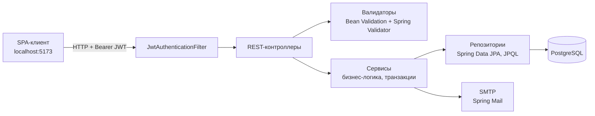
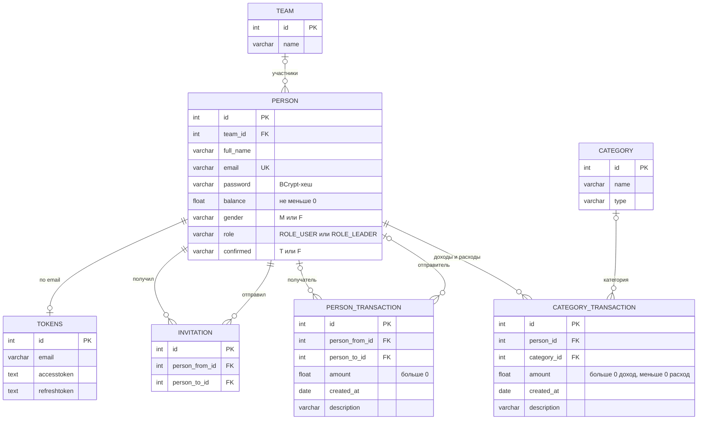

# Finance Manager — Server

REST API для учёта семейного и группового бюджета: доходы и расходы по категориям, переводы между участниками, аналитика за месяц, JWT-аутентификация с подтверждением email.


## Содержание

- [О проекте](#о-проекте)
- [Возможности](#возможности)
- [Стек](#стек)
- [Архитектура](#архитектура)
- [Модель данных](#модель-данных)
- [API](#api)
- [Запуск локально](#запуск-локально)
- [Структура проекта](#структура-проекта)

## О проекте

Сервис — серверная часть веб-приложения для совместного ведения бюджета (например, семейного). Клиент — SPA на `http://localhost:5173`, общается с сервером по REST.

Как это работает:

1. Пользователь регистрируется и подтверждает email. Для него автоматически создаётся группа, и он становится её **лидером**.
2. Лидер приглашает других пользователей. Приняв приглашение, человек переходит в группу.
3. Каждый участник записывает доходы и расходы по категориям («Продуктовый магазин», «Заработная плата», «Услуги ЖКХ» и т. д.) и может переводить деньги другим пользователям. Баланс пересчитывается автоматически.
4. Участники видят статистику по себе и по всей группе: за всё время, за выбранный месяц, с разбивкой по категориям.

## Возможности

**Аутентификация и безопасность**
- Stateless-аутентификация на JWT: access-токен живёт 4 часа, refresh-токен 21 день.
- Refresh-токен хранится в `HttpOnly` cookie. При каждом обновлении он ротируется и сверяется с последним выданным токеном в БД.
- Пароли хешируются BCrypt.
- Регистрация подтверждается по ссылке из письма. Без подтверждения войти нельзя.
- Пароль восстанавливается по ссылке, отправленной на email (Spring Mail, SMTP).
- CORS открыт только для адреса клиента.

**Группы**
- Две роли: `ROLE_LEADER` и `ROLE_USER`.
- Приглашения: отправить, принять, отклонить. Повторные приглашения и приглашения участникам своей же группы запрещены.
- Лидер может исключить участника или передать ему роль лидера.
- Участник может выйти из группы: для него создаётся новая группа, где он становится лидером.
- Если последний участник группы принимает приглашение в другую, его опустевшая группа удаляется.

**Финансы**
- Операции по категориям: знак `amount` определяет тип (положительное значение — доход, отрицательное — расход).
- Переводы между пользователями. Балансы отправителя и получателя меняются в одной транзакции (`@Transactional`).
- При добавлении, изменении и удалении операций баланс пересчитывается.
- Целостность данных обеспечивается на уровне БД: `CHECK (balance >= 0)`, `CHECK (amount > 0)` для переводов, `CHECK (person_from_id <> person_to_id)`, уникальность приглашений.

**Аналитика**
- Операции пользователя или группы за всё время или за конкретный месяц.
- Суммы доходов и расходов, сгруппированные по категориям (агрегация в JPQL-запросах).
- Последние N операций (пагинация через `Pageable`).
- Входящие и исходящие переводы отдельно.

**Валидация и обработка ошибок**
- Bean Validation (`@NotEmpty`, `@Size`, `@Email`, `@Pattern`, `@Min`) на моделях.
- Собственные валидаторы Spring `Validator` для бизнес-правил: существование участников, запрет перевода самому себе, дубликаты приглашений.
- Единый формат ответа с ошибкой: `{ "message": "...", "timestamp": 1688547600000 }`, коды `400` и `404`.

## Стек

| Категория | Технологии |
|---|---|
| Язык | Java 17 |
| Фреймворк | Spring Boot 3.0.1: Web, Security, Data JPA, Validation, Mail |
| Аутентификация | Spring Security, JJWT 0.11.5, BCrypt |
| База данных | PostgreSQL, Hibernate, JPQL |
| Утилиты | Lombok |
| Сборка | Gradle 7.6.1 |

## Архитектура

Классическая слоистая архитектура: контроллеры принимают запросы, сервисы содержат бизнес-логику и управляют транзакциями, репозитории Spring Data JPA работают с БД.



## Модель данных



## API

Базовый URL: `http://localhost:8080`.

Все эндпоинты, кроме `/api/v1/auth/**`, требуют заголовок `Authorization: Bearer <access_token>`. Текущий пользователь определяется по токену, поэтому передавать свой `id` не нужно.

### Аутентификация — `/api/v1/auth`

| Метод | Путь | Описание | Параметры |
|---|---|---|---|
| POST | `/register` | Регистрация. Создаёт пользователя и группу, отправляет письмо подтверждения | body: `name`, `email`, `password`, `gender` |
| GET | `/confirmRegistration` | Подтверждение email по ссылке из письма, затем редирект на клиент | query: `token` |
| POST | `/authenticate` | Вход | body: `email`, `password` |
| POST | `/refresh` | Новая пара токенов | cookie: `refreshToken` |
| POST | `/forgotPassword` | Отправить письмо со ссылкой для сброса пароля | body: `email` |
| POST | `/forgotPasswordConfirm` | Установить новый пароль | body: `token`, `password` |
| POST | `/logout` | Удалить refresh-cookie | — |

### Пользователи — `/people`

| Метод | Путь | Описание | Параметры |
|---|---|---|---|
| GET | `/me` | Текущий пользователь | — |
| GET | `/team` | Участники моей группы | — |
| POST | `/update` | Обновить профиль. Пустой `password` оставляет пароль прежним | body: `full_name`, `email`, `password`, `gender` |
| POST | `/kick` | Исключить участника (только лидер) | body: `id` |
| POST | `/giveLeader` | Передать роль лидера (только лидер) | body: `id` |
| POST | `/leave` | Выйти из группы (лидеру недоступно) | — |

### Группы — `/teams`

| Метод | Путь | Описание | Параметры |
|---|---|---|---|
| GET | `/my` | Моя группа | — |
| POST | `/update` | Переименовать группу | body: `name` |

### Приглашения — `/invitations`

| Метод | Путь | Описание | Параметры |
|---|---|---|---|
| GET | `/fromMe` | Отправленные мной | — |
| GET | `/toMe` | Полученные мной | — |
| POST | `/add` | Пригласить пользователя в свою группу | body: `personTo.id` |
| POST | `/accept` | Принять приглашение | body: `id` |
| POST | `/delete` | Отклонить или отозвать приглашение | body: `id` |

### Категории — `/categories`

| Метод | Путь | Описание | Параметры |
|---|---|---|---|
| GET | `/categories` | Список категорий | — |
| GET | `/byId` | Категория по id | body: `id` |

### Доходы и расходы — `/categoryTransactions`, переводы — `/personTransactions`

Адреса выборок строятся по одной схеме:

```
/{categoryTransactions|personTransactions}/{person|team}[/{фильтр}][/month|/last]
```

| Часть пути | Значение |
|---|---|
| `person` / `team` | операции текущего пользователя или всей его группы |
| `income` / `expenses` | доходы или расходы (только `categoryTransactions`). Без `/last` суммы группируются по категориям |
| `from` / `to` | исходящие или входящие переводы (только `personTransactions`) |
| `/month?timestamp=<ms>` | только за месяц, в который попадает `timestamp` (Unix-время в миллисекундах) |
| `/last?limit=<n>` | последние `n` операций. Только для `person`, у `categoryTransactions` вместе с `income` / `expenses` |

Например, `GET /categoryTransactions/team/expenses/month?timestamp=1685577600000` возвращает расходы группы за июнь 2023 по категориям.

<details>
<summary>Полный список эндпоинтов операций (33)</summary>

**`/categoryTransactions`**

| Метод | Путь | Описание |
|---|---|---|
| GET | `/person` | Мои операции за всё время |
| GET | `/team` | Операции группы за всё время |
| GET | `/person/income` | Мои доходы по категориям |
| GET | `/person/expenses` | Мои расходы по категориям |
| GET | `/team/income` | Доходы группы по категориям |
| GET | `/team/expenses` | Расходы группы по категориям |
| GET | `/person/month?timestamp=` | Мои операции за месяц |
| GET | `/team/month?timestamp=` | Операции группы за месяц |
| GET | `/person/income/month?timestamp=` | Мои доходы по категориям за месяц |
| GET | `/person/expenses/month?timestamp=` | Мои расходы по категориям за месяц |
| GET | `/team/income/month?timestamp=` | Доходы группы по категориям за месяц |
| GET | `/team/expenses/month?timestamp=` | Расходы группы по категориям за месяц |
| GET | `/person/income/last?limit=` | Мои последние N доходов |
| GET | `/person/expenses/last?limit=` | Мои последние N расходов |
| POST | `/add` | Добавить операцию. body: `category.id`, `amount`, `createdAt`, `description` |
| POST | `/delete` | Удалить свою операцию. body: `id` |

**`/personTransactions`**

| Метод | Путь | Описание |
|---|---|---|
| GET | `/person` | Все мои переводы |
| GET | `/person/from` | Мои исходящие переводы |
| GET | `/person/to` | Мои входящие переводы |
| GET | `/team` | Все переводы участников группы |
| GET | `/team/from` | Исходящие переводы участников группы |
| GET | `/team/to` | Входящие переводы участникам группы |
| GET | `/byId` | Перевод по id. body: `id` |
| GET | `/person/month?timestamp=` | Мои переводы за месяц |
| GET | `/person/from/month?timestamp=` | Мои исходящие за месяц |
| GET | `/person/to/month?timestamp=` | Мои входящие за месяц |
| GET | `/team/month?timestamp=` | Переводы группы за месяц |
| GET | `/team/from/month?timestamp=` | Исходящие переводы группы за месяц |
| GET | `/team/to/month?timestamp=` | Входящие переводы группы за месяц |
| GET | `/person/last?limit=` | Мои последние N переводов |
| GET | `/person/from/last?limit=` | Мои последние N исходящих |
| GET | `/person/to/last?limit=` | Мои последние N входящих |
| POST | `/add` | Перевести деньги. body: `personTo.id`, `amount`, `createdAt`, `description` |

</details>

### Примеры запросов

Регистрация:

```bash
curl -X POST http://localhost:8080/api/v1/auth/register \
  -H "Content-Type: application/json" \
  -d '{"name": "Иван Иванов", "email": "ivan@example.com", "password": "secret", "gender": "M"}'
```

Вход (после подтверждения email). В ответе приходит `token`, а refresh-токен сохраняется в cookie:

```bash
curl -X POST http://localhost:8080/api/v1/auth/authenticate \
  -H "Content-Type: application/json" \
  -c cookies.txt \
  -d '{"email": "ivan@example.com", "password": "secret"}'
```

```json
{
  "type": "Bearer",
  "token": "eyJhbGciOiJIUzI1NiJ9...",
  "error": null,
  "person": { "id": 16, "full_name": "Иван Иванов", "email": "ivan@example.com", "balance": 0.0, "role": "ROLE_LEADER", "...": "..." }
}
```

Добавить расход:

```bash
curl -X POST http://localhost:8080/categoryTransactions/add \
  -H "Authorization: Bearer <access_token>" \
  -H "Content-Type: application/json" \
  -d '{"category": {"id": 1}, "amount": -326, "createdAt": "2023-06-05", "description": "Сыр, батон, молоко"}'
```

## Запуск локально

### Требования

- JDK 17
- PostgreSQL 10+
- SMTP-аккаунт для отправки писем (например, Gmail с паролем приложения)

### 1. База данных

Создайте базу и выполните скрипт со схемой и тестовыми данными:

```bash
createdb finance_manager
psql -d finance_manager -f src/main/resources/db/tables.sql
```

Затем добавьте поля и таблицу, которые использует текущая версия приложения, но которых нет в `tables.sql`:

```sql
ALTER TABLE person   ADD COLUMN confirmed varchar(1);
ALTER TABLE category ADD COLUMN type      varchar(10);

CREATE TABLE tokens
(
    id           int generated by default as identity primary key,
    email        varchar(50) not null unique,
    accesstoken  text,
    refreshtoken text
);
```

### 2. Настройки

Параметры подключения к БД и SMTP лежат в `src/main/resources/application.properties`. Их можно поменять прямо в файле или переопределить переменными окружения, не трогая файл:

| Переменная | Назначение |
|---|---|
| `SPRING_DATASOURCE_URL` | например, `jdbc:postgresql://localhost:5432/finance_manager` |
| `SPRING_DATASOURCE_USERNAME` | пользователь PostgreSQL |
| `SPRING_DATASOURCE_PASSWORD` | пароль PostgreSQL |

### 3. Запуск

```bash
./gradlew bootRun        # Linux / macOS
gradlew.bat bootRun      # Windows
```

Сервер поднимется на `http://localhost:8080`.

## Структура проекта

```
src/main/java/ru/ServerRestApp/
├── JWT/
│   ├── auth/           # AuthenticationController и AuthenticationService: регистрация, вход, refresh, сброс пароля
│   ├── config/         # SecurityConfiguration, JwtAuthenticationFilter, JwtService, ApplicationConfig
│   ├── Request/        # DTO запросов аутентификации
│   └── Response/       # DTO ответов аутентификации
├── config/             # настройка валидатора Spring MVC
├── controllers/        # REST-контроллеры: people, teams, invitations, categories, транзакции
├── services/           # бизнес-логика и транзакции, отправка email
├── repositories/       # Spring Data JPA репозитории с JPQL-запросами
├── models/             # JPA-сущности
├── validators/         # валидаторы бизнес-правил
└── util/               # исключения, формат ошибок, получение пользователя по токену
```